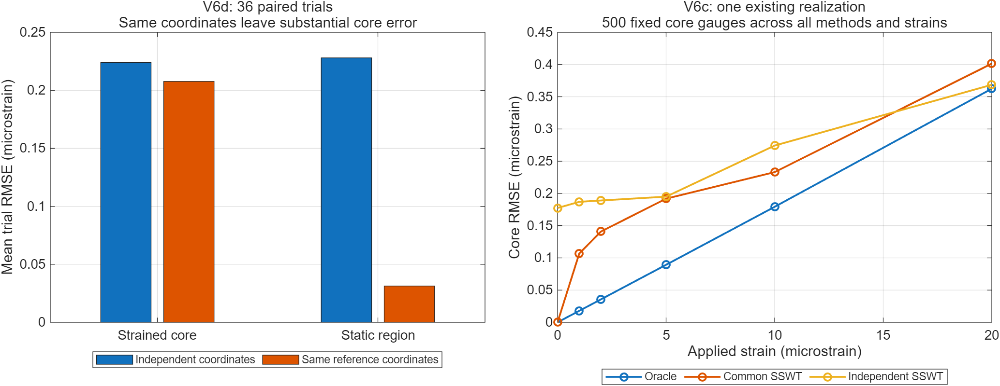

# OFDR 研究方向评估：保留相位校准主线，停止围绕 V7d 门限持续迭代

评估日期：2026-11-14。源码基线：`6a15a2b`。研究目标：**论文方法创新与可解释机理**；已有实验平台，尚无可用实测数据。

本次读取 V6–V7d 源码、历史研究记录、用户提供的最新日志及本地保存的实验结果；使用 MATLAB 对已查看数据做只读复核，并核对相关论文公开元数据/摘要。没有运行新随机试验，没有使用 V7c/V7d 预留冻结集，没有验证新算法。图表中的新增数值是历史数据的事后重评分。

**判断：V7d-PF 值得作为候选可行性保护逻辑保留，但不值得继续作为论文主突破口。更值得研究的是：为什么共模坐标误差在零应变时能抵消，在非零应变时仍造成显著误差，以及如何利用辅助干涉观测约束这部分误差。** 目前证据足以支持安排一轮有明确退出条件的机制实验，尚不足以宣称该问题的新颖性或新方法有效。

## 1. 哪些方向值得继续

| 方向 | 判断 | 依据与下一步 |
|---|---|---|
| V7d 逐候选可行性 | 保留为工程保护，降低研发优先级 | 完整拟合边界 0/24 暴露，最终决策 0/24 改变；只需有界的机制压力验证 |
| 继续调整 α 网格、0.8 MHz 门限、CV 接受阈值 | 暂停作为主线 | 没有证据表明当前停滞主要由这些数值造成；现有两个端点之间的选择空间较小 |
| 静态参考段相位一致性 SAPC | 保留作基线与辅助约束 | V7b 曾有小幅平均正收益，但不能靠静态区指标解决所有非零应变误差 |
| 共模/差模误差与非零应变的耦合、可观测性 | **首选机制方向** | 已有数据直接反驳“共模一致便等于应变准确”的泛化推断，适合构造可证伪模型 |
| 辅助端直接相位估计及双扫描联合估计 | **首选算法方向，但先补强基线** | 可为静态相位看不见的共模误差提供独立信息；需先比较直接相位法、SEFR 等 |
| 衰落抑制、频率分集、相位与互相关结合 | 条件性备选 | 若改进坐标后主要误差仍集中在低相干位置则优先；相关文献成熟，查新压力大 |
| 加大平滑窗口、增加 NUFFT 精度、直接上神经网络 | 暂不作为主线 | 尚未证明是主瓶颈；平滑改变空间响应，网络缺少实测分布与物理识别依据 |

## 2. 必须先纠正的覆盖率解释

原 V7d 文档将 `common_valid_fraction=0.4848` 与单方法约 `0.90` 并列，并解释为取交集造成严重测点损失。**这两项的分母不同，该解释不成立。**

- `v7d_run_trial.m`：共同有效数除以整个重构网格的 Gauge 数 `numel(common)`。
- `v6c_demodulate_strain.m`：单方法有效数除以 Gauge 中点落入 ROI 的数量。
- MATLAB 已验证共同计数恢复为整数、首个 trial 的保存掩码吻合、有效位置位于 ROI，以及单方法比率的分母。

| 量 | 复核结果 |
|---|---:|
| 整个网格 Gauge 数 | 4085 |
| ROI 内 Gauge 中点数 | 2201 |
| 两端都落在 ROI 的 Gauge 数 | 2189 |
| 24 次平均共同有效数 | 1980.542 |
| 共同有效率，整个网格作分母 | 48.4833% |
| 共同有效率，与单方法相同的 ROI 中点分母 | **89.9837%** |
| 共同有效率，ROI 两端合格分母 | 90.4770% |
| Affine 单方法有效率，ROI 中点分母 | 90.8697% |

因此，与 Affine 相比，七方法交集的额外覆盖损失约为 **0.886 个百分点**，不能说丢掉了近半测点。ROI 中点口径与两端口径也应明确区分；这里推荐先用中点口径做历史同口径核对。

这项更正**不改变已保存的 Core/Holdout RMSE、α 或胜负计数**：历史评分已在相同的交集位置上完成。约 10% 的未覆盖位置及 Oracle 参与评价门控仍值得报告，但“掩码交集损失一半”不能作为新研究主线的依据。旧的 `minimum_common_valid` 检查也使用全网格分母；未来改成 ROI 分母会改变门控语义，应另立版本，不能悄悄重算历史结果。

## 3. V7d 零收益到底说明了什么

### 3.1 没有触及完整拟合边界，但不等于所有新增约束都没起作用

24/24 成功，完整额外修正峰值为 0.048628–0.709914 MHz，均小于 0.8 MHz。V7c 与 V7d 的最终 α、Core/Holdout 分数逐 trial 相同。

不过，**trial 8 的折内合法非仿射候选由四个减少为三个**，最终仍选 α=0.5。准确描述应为“完整拟合提前拒绝边界未暴露；至少一个 trial 的折内候选集合受到约束，但最终选择未改变”，不能笼统写成“所有新增约束从未触发”。

若将这 24 次视为同一固定工况下独立同分布的抽样，零次完整边界事件给出的事件概率单侧 95% 二项上限为 `1-0.05^(1/24)=11.73%`。这只是该工况下的概率上界，不是实际发生率估计，更不能外推到低 SNR、长距离或真实仪器。

### 3.2 门控的选择能力仍没有证据支撑

本轮开发数据的只读计数：

| 事后诊断 | 数量 |
|---|---:|
| 接受非仿射修正 | 9/24 |
| 接受后 Core 优于 Affine | 5/9 |
| 接受后 Core 劣于 Affine | 4/9 |
| 回退到 Affine | 15/24 |
| 回退时 Full SAPC 的 Core 本来更好 | 11/15 |

这不能证明门控总体无效，但它表明应该先研究**验证目标是否能预测真实任务收益**，而不是继续假定“门限太保守”就是主因。V7c 的另一批开发数据也出现接受后 5 胜、6 负，但两批不同种子结果不能当成配对比较。

### 3.3 当前输出之间的选择空间并不大

| V7d 开发集上的输出 | Core RMSE 均值（με） |
|---|---:|
| Affine | 0.213230 |
| Full SAPC | 0.212063 |
| V7d | 0.212824 |
| 每个 trial 用真值事后挑 Affine/Full 中较好者 | 0.209539 |

最后一行是**不可部署的两端点事后诊断**：平均比 Affine 改善 0.003691 με，约 1.73%。它不是连续 α 的最优值，也不是更丰富校正器的性能上界；它只说明在这两个已保存输出之间，单靠“选得更聪明”能挖出的空间有限。

V7b 的 100 次已完成盲测中，Full SAPC 相比 Affine 改善 0.003482 με，95% CI `[0.001994,0.005146]`，约为 Affine 均值的 1.59%，但 35/100 次退化。这支持保留 SAPC 作为基线，尚不足以支持一系列只修改门控规则的论文主张。

## 4. 真正值得追查的线索：共模一致仍不能保证非零应变准确

### 4.1 36 次 V6d 数据已给出明确线索

| V6d 处理 | Core RMSE（με） | 静态区 RMS（με） |
|---|---:|---:|
| full_diff：参考/测量分别采用各自 SSWT 坐标 | 0.223962 | 0.228018 |
| no_diff：两次都采用参考 SSWT 坐标 | 0.207679 | 0.031327 |

切换为共同参考坐标后，Core 平均误差只减少约 **7.27%**，静态区却减少约 **86.26%**。所以，对静态零应变目标很有效的处理，可能只解决受应变区误差的一小部分。

这里的 `no_diff` 仍含参考扫描的绝对坐标误差，并非 Oracle。两种处理还会同时改变“参考/测量误差平均值”，不能把两个 RMSE 相减或相减平方直接解释成正交误差贡献，也不能据此宣布所有相对校正器都存在 7.27% 的收益上限。

### 4.2 固定同一批测点后，结论仍成立

本次从已有 V6c MAT 中取出 6 个应变水平、3 种方法的结果，固定为它们全部共同有效的 **500 个 Core Gauge**，没有重跑仿真。

| 施加应变（με） | Oracle | Common SSWT | Independent SSWT |
|---|---:|---:|---:|
| 0 | 0 | 0 | 0.177380 |
| 1 | 0.017807 | 0.106736 | 0.186980 |
| 2 | 0.035637 | 0.140868 | 0.189066 |
| 5 | 0.089263 | 0.191855 | 0.195003 |
| 10 | 0.179229 | 0.233075 | 0.274258 |
| 20 | 0.362491 | 0.401436 | 0.368612 |

单位均为 Core RMSE，με。这是**一个历史散射体/辅助噪声实现的描述性重评分**，没有独立统计检验；不能据此推断独立误差在 20 με 时总体有益。



左图是 V6d 36 次配对均值，右图是 V6c 单一实现的固定掩码结果；不同面板不共用试次，不能横向相减。图中没有把均值误差条省略后冒称显著性。

两点尤其重要：

1. 零应变下，共同重构坐标作用于完全相同的主信号，差分相位可以精确为零；这并不检验绝对坐标是否准确。
2. 非零应变下，共同错误坐标仍产生明显误差；而 Oracle 本身也有非零误差。Oracle 只是**当前前向模型、有限带宽、重构与解调链的参考表现**，不是物理不可突破的噪声极限。

## 5. 首选研究问题及下一项最有价值的实验

### 5.1 将问题改写为“非零应变条件下的共模/差模敏感性”

令两次坐标误差为 `e_r`、`e_m`，定义：

\[
e_c=(e_r+e_m)/2,\qquad e_d=e_m-e_r.
\]

局部小扰动、固定有效掩码、相位未跨周时，完整处理链可尝试线性化为：

\[
\delta\hat\varepsilon\approx J_c(\varepsilon,R)e_c+J_d(\varepsilon,R)e_d.
\]

`R` 表示散射场及观测条件。应当通过数值扰动/理论推导确定这两个灵敏度，而不是预先假定 `J_c=0`。当前零应变、无主探测噪声、相同信号的条件下，共同坐标扰动确实不改变零差分；非零应变后，这种不变性通常不能直接沿用。

直观上，有限带宽重构混合邻近散射体；对散射体施加随位置变化的应变相位，再经过含坐标误差的重构，并不保证等于先重构再逐点加上应变相位。可用重构算子与应变相位乘法算子的不交换性作简化分析的入口；实际模型还含群时延变化、窗和密度权重变化，不能把这个简化解释当成已经证明的完整物理模型。

值得争取的贡献是：**找出这种误差在何种应变、带宽、散射统计、距离和 Gauge 条件下出现，并构造可由实际观测确定的补偿或风险预测方法。** “误差相关性重要”本身已有 V6b 证据，也接近已有研究；必须向非零应变条件、可观测性和可验证预测进一步推进。

### 5.2 做固定共模/差模定义的 2×2 机制实验

保持同一物理配对信号不变，只修改重构坐标：

| 组别 | 参考坐标 | 测量坐标 | 用途 |
|---|---|---|---|
| 00 | `q_true` | `q_true` | 当前解调链参考误差 |
| 10 | `q_true+e_c` | `q_true+e_c` | 单独共模作用 |
| 01 | `q_true-e_d/2` | `q_true+e_d/2` | 单独差模作用 |
| 11 | `q_true+e_c-e_d/2` | `q_true+e_c+e_d/2` | 两者及交互作用 |

这是**真值辅助的机制消融，不是可部署算法**。首先用预先固定的 0/1/5/10 με、少量全新配对散射/噪声试次检查趋势，记录全部失败及单调性约束。条件、种子和评价方法在运行前写入新开发记录，不能根据是否出现正收益挑试次。

同一组比较采用固定共同位置，保持实际 Gauge、平均窗口、窗函数、主信号和噪声一致。使用位置误差平方的平均值 `M_ij`，报告交互项：

\[
I=M_{11}-M_{10}-M_{01}+M_{00}.
\]

`I` 是有符号的交互诊断，可正可负，不强制解释成一种非负噪声功率。跨试次以完整 trial 为统计单位。这比继续把非正交 RMSE 差解释成“某种误差占比”更有信息。

**继续条件：** 共模影响或交互效应跨新散射实现稳定出现，且由灵敏度模型预测的方向/量级能外推到未用于拟合的应变条件。

**退出条件：** 效应在数值/散射密度收敛后消失，或新条件下不稳定、无法预测。前者优先修正仿真模型，后者不把该机制包装成方法创新。

### 5.3 同时审计 Oracle 误差来自哪里

当前配置散射体间隔为 **1.5 mm**，距离网格约 **0.818 mm**，尚未证明该离散散射模型的统计收敛。Oracle 在同一实现下随应变近似增长，值得先做以下有界核查：

- 在相同窗与密度权重下，用直接 NUDFT 检查选定位置的复数结果，区分 NUFFT 近似误差与物理/解调误差。
- 缩小散射体间隔并保持散射强度归一化及物理带宽，检查统计分布是否收敛；改变网格时不能把不同随机场的单次差异当成纯离散化效应。
- 单独诊断载波相位与群时延变化；关闭某一项只可作为非物理机制消融，不能作为更准确的最终模型。
- 在相同实际 Gauge 下比较原始 phasor 与 9-bin 平均，并测量应变边缘响应。

当前实际 Gauge 为 **9.813 mm**，9-bin 平均的端点包络跨度为 **16.355 mm**，还未计入重构点扩散函数的非局部影响。该数值不能直接称作完整空间分辨率；也不能因为距离采样间隔约 0.818 mm 就宣称应变测量分辨率是 0.818 mm。

## 6. 算法方向：让辅助干涉观测约束共模误差

### 6.1 先补一个目前缺少的强基线

当前路径是辅助干涉信号 → SSWT 瞬时拍频 → 积分 → 光频坐标。单一 81 点滑动平均变差，只能否定该实现，不能否定相位法、所有平滑或正则化。

在当前冻结频率近似模型中，可比较带通后的解析信号相位：

\[
\hat q(t)-\hat q(t_0)=\frac{\operatorname{unwrap}\hat\theta_a(t)-\operatorname{unwrap}\hat\theta_a(t_0)}{2\pi\tau_a}.
\]

实现时需处理频带、边界、幅度低谷、相位跨周与有效时延标定，并对各方法统一保留频带和空间响应。这是标准方法类，**建议作为 Hilbert/直接相位解调基线，不宣称它本身是创新**。可再选一种合理的 PLL/状态空间估计基线；不必一开始堆叠大量方法。

若简单基线已明显优于 SSWT+SAPC，应优先定位脊线偏差/积分累计误差，而不是继续给较弱的上游估计加门控。

### 6.2 再考虑联合估计

候选结构是：辅助波形给出各扫描轨迹的观测约束；静态段给出扫描间一致性约束；单调性与轨迹平滑先验控制病态方向。SSWT 可作为初始化和置信度来源。

方法必须允许真实扫描差异，不能强行令两次轨迹相等。先研究各项权重对应的观测噪声与可辨识方向，再考虑优化器；不建议一开始更换为复杂网络或无限增加基函数。

静态相位数据主要提供相对信息：在完全静止、相同主信号的当前模型下，共同改变两条重构坐标仍保持零差分，无法据此确认共同坐标准确。辅助波形/独立频率参考是打破这种不确定性的候选信息来源。额外参考段能改善部分空间可辨识性，但不能单凭增加静态段便保证识别所有共模方向。

仅凭相位目标与当前四个基函数的 Hessian 满秩，也不能推出它们对所有实际坐标误差充分可观测。建议检查白化、适当归一化后的灵敏度奇异方向，以及这些方向在新静态区域和非零应变任务上的响应；不要把更多基函数或更大的正则化条件数误当作更多真实信息。

**算法的继续条件：** 使用可观测输入，跨新物理条件优于强基线，在相同实际空间响应与覆盖条件下有可重复收益，并且能解释改善来自哪个可辨识误差方向。

## 7. 两条条件性备选路线

### 7.1 真实双扫描频带与延迟不匹配

目前 `v6c_forward_pair` 明确使用相同真实 TLS 轨迹，主探测噪声关闭。改变两次都相同的 ripple 并没有验证独立扫描漂移。

有平台后，优先采集扫描间起点/跨度变化、触发偏移、辅助时延稳定性。MZI 相位差提供光频增量；未知绝对起点需要额外可观测约束。当前逐扫描减去首样本的归一化，不能自动解决真实起点失配。

SEFR 已处理参考/测量扫描范围变化与非线性共校正，必须作为对照。可探索的是在不确定辅助延迟、噪声协方差或特定观测缺失条件下，是否仍有可证明且实测成立的改进，不能仅以“统一双扫描坐标”作为创新。

若扩展至长距离，还应使用激光相位的延迟差模型检查冻结频率近似，并确认 `fs > 2*tau_max*max(dnu/dt)`。不能只把当前 2.55 m 量级模型的距离参数改成几十米。

### 7.2 相干衰落与解调器鲁棒性

若 Oracle/更好校准后，残余误差仍集中于低幅度、低相干位置，可优先研究固定空间响应下的复相位稳健估计、频率/偏振分集或相位与互相关互补。

频移平均、旋转矢量求和、相位引导的自适应互相关已有工作。通过缩窄子频带换取分集会改变空间分辨率；分支也可能相关。必须报告真实边缘响应、有效覆盖和分支协方差，不能只给“有效位置上的更低 RMSE”。

本次覆盖率更正降低了“交集导致严重失效”的证据强度，故不把这一方向列为当前第一优先级。

## 8. 已核对的文献边界

本次核对来源为 Crossref 的 DOI 元数据与可用摘要，属于有边界的查阅，**没有完成全文级系统查新**。摘要缺失的条目只核对了标题与日期。下列性能数字也不能与本项目直接横向比较。

| 工作 | 已核对内容 | 对本研究的约束 |
|---|---|---|
| [Dang 等，2022，SSWT](https://doi.org/10.1364/OE.477771) | SSWT 辅助 MZI 动态波长校准 | 使用 SSWT 本身不是新贡献 |
| [Ding 等，2012，NUFFT](https://doi.org/10.1063/1.4729376) | 非均匀光频重构抵抗扫频非线性 | SSWT 与 NUFFT 的组合不能单独证明创新 |
| [Chen 等，2024，SEFR](https://doi.org/10.1364/OL.548127) | 同时处理两次扫描的随机范围变化和扫频非线性 | 双扫描频带统一已有直接强基线 |
| [Liu 等，2025，相位预测补偿](https://doi.org/10.1109/JLT.2024.3496724) | 标题及日期；本次接口无摘要 | 相位预测/自适应补偿方向必须阅读全文对照 |
| [Yang 等，2025，全量程精度](https://doi.org/10.1364/OL.547699) | RPN 方差与干涉延迟关系，使用延迟模块抑制 | “考虑距离、延迟与残余相位噪声”已有研究 |
| [2026，全光栅光纤的相位与互相关结合](https://doi.org/10.3390/s26031004) | 频移平均、旋转矢量求和、相位边界引导互相关 | 混合解调不是空白；其光纤对象与普通 Rayleigh 传感不同 |
| [2026，长距离插值重采样](https://doi.org/10.1016/j.optcom.2026.133155) | 标题及发表时间；本次接口无摘要 | 仅凭标题不能推断其与拟议方法的具体差异 |

论文立项前，至少对 SEFR、相位预测补偿、RPN 延迟关系三篇全文建立输入、假设、目标函数、校正对象、误差预算和实测条件对照表。现有证据支持一个候选问题，不支持“首次发现共模误差作用”这样的优先权表述。

## 9. 建议下一轮工作的顺序和退出标准

| 步骤 | 要交付的证据 | 继续/停止判断 |
|---|---|---|
| P0：历史复核 | 本文、审计 JSON、固定掩码结果 | 已完成；不为相同默认工况继续追加 V7d 种子 |
| P1：Oracle 与散射模型核查 | 直接 NUDFT、散射密度收敛、原始/平均相位、边缘响应 | 若主要效应是模型/数值伪影，先修正模型 |
| P2：共模/差模 2×2 消融 | 固定评价位置的主效应、交互项、跨应变预测 | 只有稳定、可解释且能外推的效应才进入方法开发 |
| P3：补强基线 | SSWT、直接相位法、Affine、SAPC；真实失配下加入 SEFR | 若标准方法已解决问题，重新定位贡献，不包装弱基线差距 |
| P4：观测约束的联合估计 | 无真值拟合、相同空间响应的收益、覆盖和风险 | 新开发结果支持实际意义后，再设计新的冻结验证 |
| 平台采集并行推进 | 同步原始主/辅助波形、时间戳和采集参数 | 尽早用实际误差分布决定仿真范围 |

建议把 P1–P3 作为一轮有限投入的可行性评估，而不是立即建设一个大而全的 V8。可先提出“相对最佳合理基线约 5% 的 Core 改善、空间响应和覆盖不劣化”作为讨论用的工程筛选线；这不是已冻结阈值，也不是发表门槛。若课题主要贡献是可验证误差机理，可以不追求任意百分比，但必须有预测能力和实验支撑。

最终统计设计应预先指定主终点、实际有意义的差异、关键非劣指标与多重比较处理；根据新开发集的 trial 级方差估计样本量。不要机械地认为 100 次就充分，也不要把重叠 Gauge 或同一静态扫描的像素当成独立重复。

V7d 的边界机制若仍需关闭悬而未决的问题，可以先用预先构造的修正幅度、单调性边界做软件验证；再按平台合理范围预先设置物理压力条件，完整报告事件暴露率及条件收益。人为构造的超限案例不代表仪器自然分布，禁止以挑 seed 或下调门限来证明普遍性能收益。

### 最小平台数据建议

先获取一组连续静态扫描，例如 30–50 次，同步保存原始辅助与主干涉通道，保留采样率、触发/时间戳、TLS 标称端点、辅助有效时延、增益与滤波设置。该数量用于描述误差，不等于最终独立样本量；连续扫描的时间相关性应单独检查。

再获取少数有独立标定的非零应变水平与静态参考区，保留原始采集文件，并做独立采集时段的重复。不要把执行器设定值自动当成精确应变真值；若应变量暂时无法独立标定，先将这些数据用于稳定性/一致性验证。

这比在缺少实际扫描漂移、探测噪声与延迟信息的情况下，继续扩大当前理想模型的默认 Monte Carlo 更有助于选对论文问题。

## 10. 复现、证据与结论追溯

新增的 [只读 MATLAB 脚本](../matlab/research_audit_20261114.m) 已在 MATLAB R2025a 成功运行，输出完成标记和正常退出码。它只读历史 MAT，生成 [JSON](research-audit-2026-11-14.json) 与上述图，不调用拟合器或随机试验入口。原始 MAT/CSV 未被改写，算法、种子、阈值及冻结开关未改动。

在包含顶层 `README.md` 的仓库根目录执行：

```matlab
run('matlab/research_audit_20261114.m')
```

| Evidence | 来源 | Finding | 下一条 Path |
|---|---|---|---|
| E01 | V7d 开发 MAT、脚本计数断言、两处有效率源码 | F01：分母不一致，不能据此宣称交集损失近半 | P0：同口径报告覆盖；未来协议明确分母 |
| E02 | V7d 开发 MAT、最新用户日志 | F02：完整边界未暴露，trial 8 折内候选受限但输出不变 | 将 PF 保留为保护逻辑，有限验证边界机制 |
| E03 | V7d 逐 trial Core 与 α | F03：门控错选仍存在，两端点选择空间有限 | P2/P3：检查目标与模型，不继续盲调阈值 |
| E04 | V6d 36 次结果；V6c 固定 500 Gauge 重评分 | F04：共同坐标无法消除所有非零应变误差 | P1/P2：Oracle 核查和共模/差模交互实验 |
| E05 | V7b 已查看盲测 CSV 与结果文档 | F05：SAPC 有小幅历史平均收益 | 保留强基线，不能把整个主线判死 |
| E06 | 上述 DOI 的公开元数据/摘要 | F06：多项拟议方法类已有直接相关工作 | 全文查新后限定具体贡献 |

E01–E05 的文件型证据可通过上述脚本及 `Get-FileHash` 复核；E06 通过 DOI 页面或 `https://api.crossref.org/works/{DOI}` 复核，全文内容不在本次已验证范围。

| 原始文件 | SHA-256 |
|---|---|
| `matlab/v7d/output/V7d_DEVELOPMENT_results.mat` | `AF4F07FD6E87FDCE29F26C254793F6DF185B42C07E90A228016DEB8DF5C6D781` |
| `matlab/v6d/output/V6d_component_ablation.mat` | `FCA7B818E350F81C46EF5FA56DC0785634203FD1E430466CD39AD8F66479EF1B` |
| `matlab/v6c/output/V6c_nonzero_strain.mat` | `1474FBEAB0AF40922A424617A353BE633757B4917DACCEB414044C2949D1840A` |
| `matlab/v7b/output/V7b_blind_trial_data.csv` | `91E8F4793C6A3BDB7BF5A27F1BC90103504663A094722017A264F39616F585C1` |

当前最值得投入的下一步是 **Oracle/散射模型核查 + 固定共模/差模定义的 2×2 非零应变实验**。这两项能判断瓶颈来自仿真、信息不足还是估计器，从而决定联合校准方向是否值得继续。
